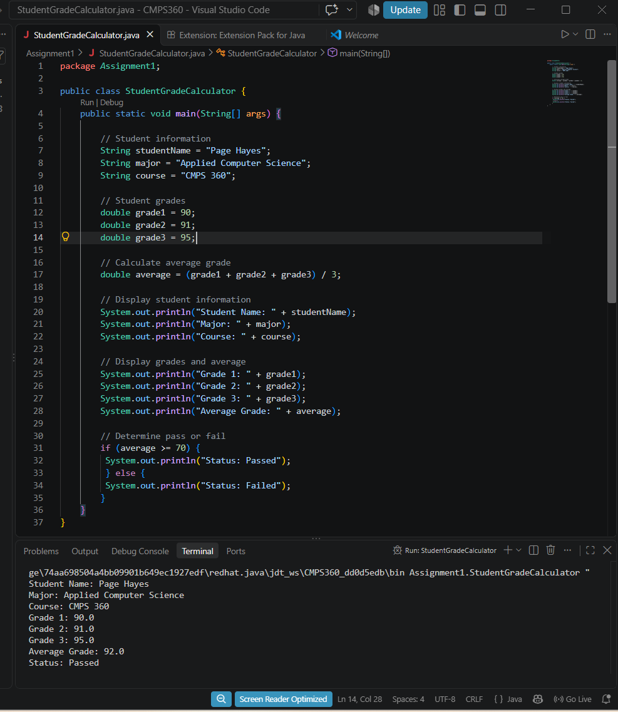

# CMPS 360 - Assignment 1

## Student Grade Calculator

This program was created using Java in Visual Studio Code. The program shows a student's information, calculates the average out of three grades, and determines if the student passed or failed based on the average.

## How It Works

The program uses the student's name, major, course, and three grades. It takes those three grades, adds them together, and divides by three to get the average. If the average is 70 or higher, the student passes. If it is below 70, the student fails. This helps show how Java can be used to calculate grades and display the results.

## How to Run the Program

1. Open the CMPS360 folder in Visual Studio Code.
2. Open the Assignment1 folder and select StudentGradeCalculator.java.
3. Click Run to start the program.
4. The student's information, grades, average, and pass or fail status will show up in the terminal.

## Example Output

```text
Student Name: Page Hayes
Major: Applied Computer Science
Course: CMPS 360
Grade 1: 90.0
Grade 2: 91.0
Grade 3: 95.0
Average Grade: 92.0
Status: Passed
```

## Screenshot

