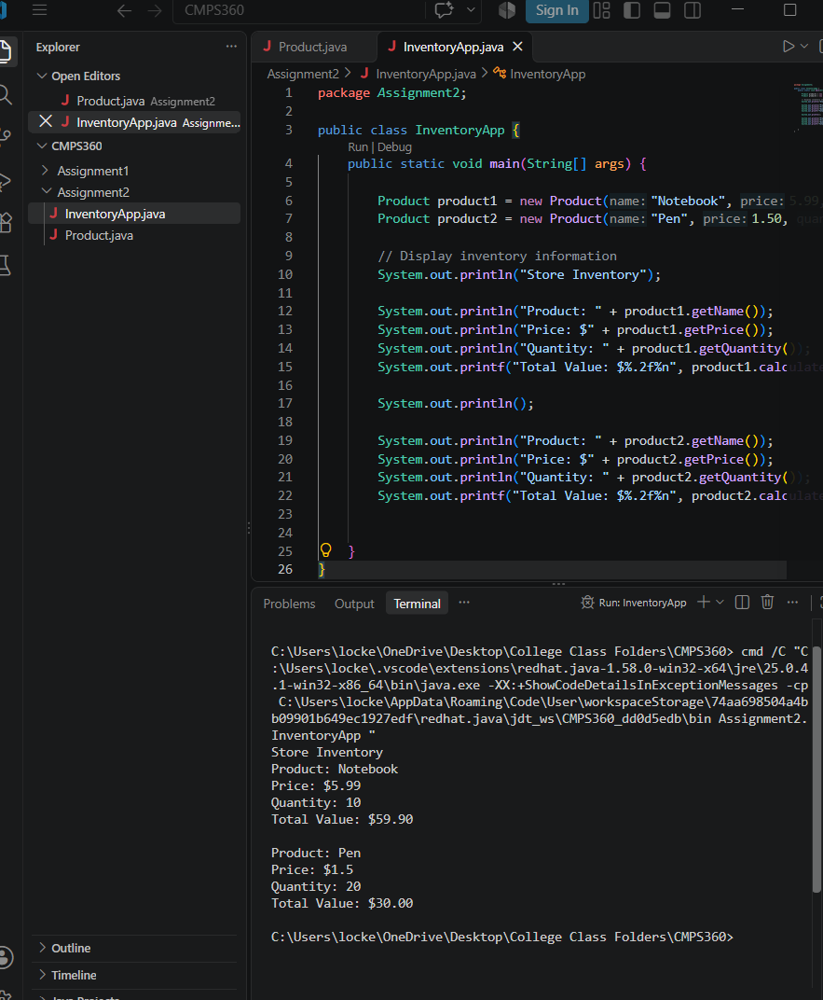
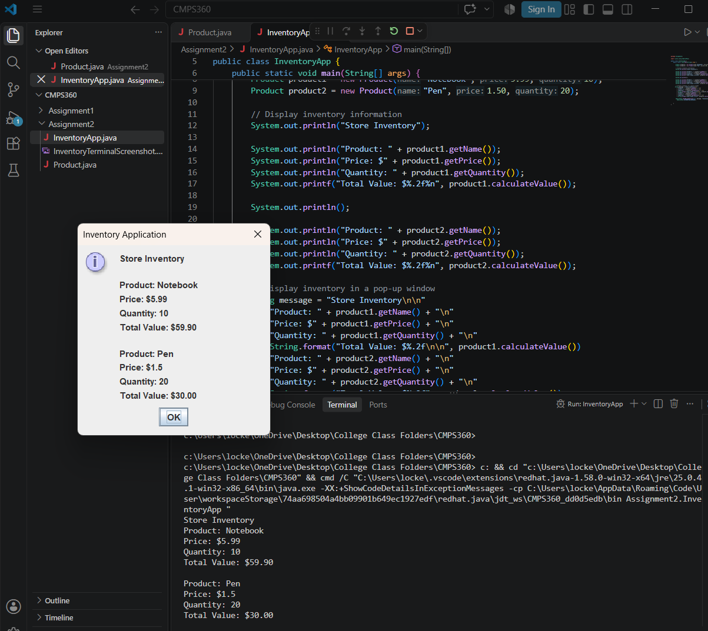

# CMPS 360 - Assignment 1B

## Inventory Application

For this assignment, I created an Inventory Application using Java in Visual Studio Code. The program has two products, a notebook and a pen. It calculates the total value of each product.

## How It Works

The program uses two Java files, Product.java and InventoryApp.java. Product.java holds the name, price, and quantity of each product. It is also able to calculate the total value. InventoryApp.java shows the product information in the terminal and in a pop-up window too. 

## How to Run

Open InventoryApp.java in Visual Studio Code and click Run. The results will show in the terminal and in a pop-up window.

## Screenshots

### Terminal Output

### GUI Pop-Up Window

